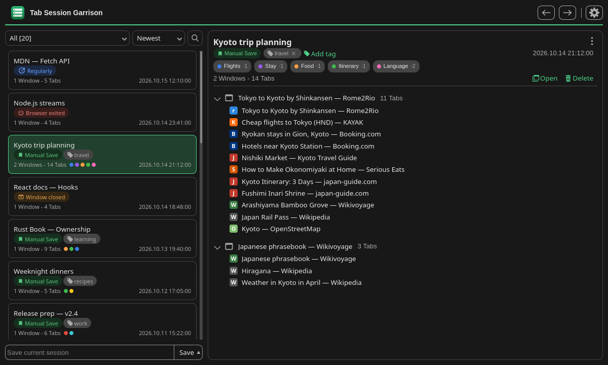
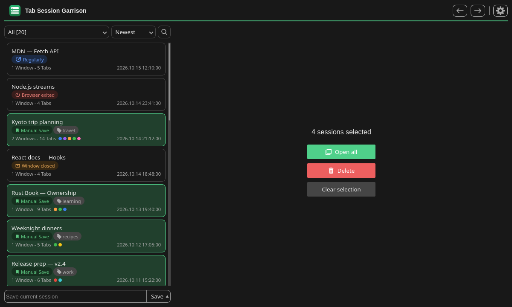
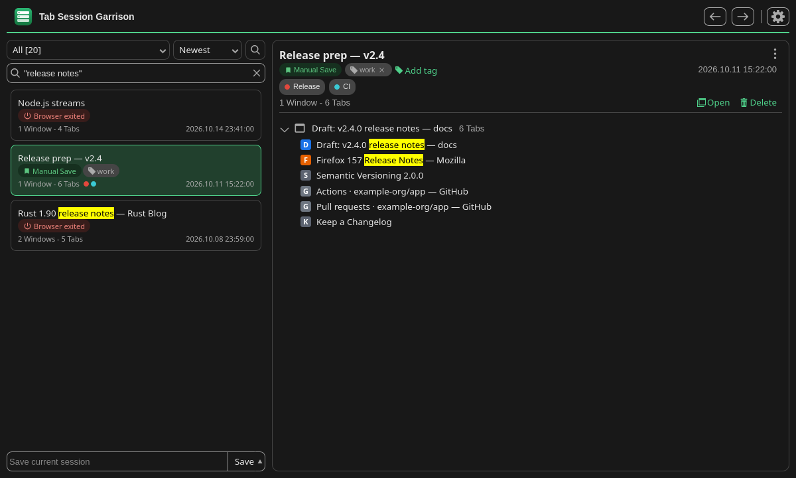
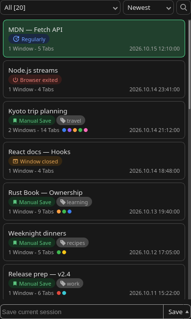
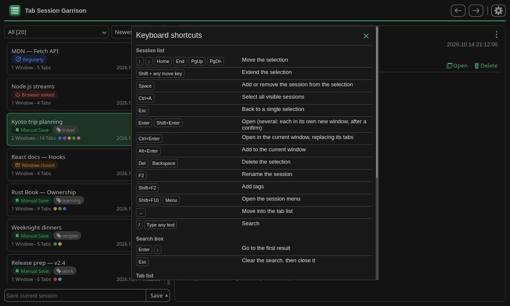

# <sub></sub> Tab Session Garrison

**Keyboard-first session management for Firefox.** Save and restore windows and tabs — with fast multi-select, full keyboard navigation, and tab-group awareness for wrangling large numbers of saved sessions.



Tab Session Garrison is a personal fork of [**Tab Session Manager**](https://github.com/sienori/Tab-Session-Manager) by Sienori, focused on power-user controls: selecting, navigating, restoring, and deleting sessions without leaving the keyboard — and clearing out the noise that builds up when you auto-save constantly.

---

## Features

Everything Tab Session Manager does — save and restore the state of windows and tabs, automatic timed saving, tagging, search, import/export, and native tab-group save/restore — **plus:**

### Selection & bulk actions

- **Multi-select** sessions with Ctrl/Cmd-click, Shift-click ranges, or the keyboard
- **Full keyboard navigation** — the list, search, the tab list, menus and dialogs all work from the keyboard, with a **?** cheat sheet in the popup (see the [keyboard reference](#keyboard-reference))
- **Bulk delete** with a single **"undo all"** — clear out dozens of stale auto-saves at once, and still get them back if you misclick
- **Bulk restore** — open every selected session at once, each in its own new window (with a confirm so a stray keypress doesn't flood your screen)
- An **"N selected" summary** panel — with **Open all** and **Delete** actions — so you always know what a bulk action will hit



### Tab groups

- **Group indicators** — every session shows its Firefox tab groups at a glance: colored, named chips in the detail pane, colored dots on each list row, and in the tab list each group's tabs carry the group's colour and name
- **Add a session to your current window as a tab group** — drop a saved session's tabs into the window you're in, tidied into one named group (and it preserves the session's own groups when it already has them)
- **Phantom-group masking** — older auto-saves that captured stray groups from other windows are cleaned up at display time, non-destructively

### Search

- **Exact phrases** — put words in quotes (`"release notes"`) to find that phrase inside a single tab title, session name or group name. Without quotes, each word can match anywhere in the session. An unfinished quote counts as a phrase while you type, and curly quotes work too
- **Tab-group names are searchable** — type a group's name to find every session that contains it
- Matches are highlighted in the list and in the detail pane, and the filter menu shows how many sessions match (`All [3/20]`)



### Reliability & polish

- **Failed saves are visible** — if saving ever fails (a full disk, a broken database), a red **!** appears on the toolbar icon and the popup says since when and why, instead of auto-save quietly stopping ([upstream #1667](https://github.com/sienori/Tab-Session-Manager/issues/1667)). The next successful save clears it
- **Says why a tab couldn't open** — the "This page can not be opened" placeholder now shows Firefox's reason, e.g. "Illegal URL"
- **Device name in backup file names** — optional, so backups from several computers sharing one folder can be told apart ([upstream #1664](https://github.com/sienori/Tab-Session-Manager/issues/1664))
- **Durable auto-save** — fixes an upstream bug where periodic auto-save could silently stop after the browser suspended or restarted; the alarm now self-heals
- **Session types at a glance** — every session shows how it was saved, each with its own icon and tint: **Manual Save** (green bookmark), **Regularly** (blue clock), **Window closed** (amber window), **Browser exited** (red power). The saves you deliberately keep finally stand out from the auto-save noise (see [How a session gets its type](#how-a-session-gets-its-type))
- **Undo count at a glance** — the undo/redo buttons carry a small badge with how many steps you can go back or forward
- **Add several tags at once** — type `work, reading, later` in Add Tag and each becomes its own tag
- **Imports always show up** — sessions exported with the internal "temp" marker used to import invisibly ([upstream #1502](https://github.com/sienori/Tab-Session-Manager/issues/1502)); the marker is now dropped on import
- **Restore respects your settings** — with **Save tab groups** turned off, restoring a session no longer recreates (and thereby re-saves) the tab groups you opted out of; tabs come back flat ([upstream #1635](https://github.com/sienori/Tab-Session-Manager/issues/1635))
- **A cohesive visual identity** — its own green session-stack logo and a boxed "card" layout across the popup and options pages, with one consistent green accent, pill buttons, and **dark theme by default**. In Settings, the section you're scrolled to is spotlighted while the rest dims, so a long settings page stops feeling like a wall

### Fast on large profiles

The popup was reworked to stay responsive when you've got hundreds — or thousands — of saved sessions:

- **Instant list interactions** — selecting, searching, and arrow-keying no longer walk the whole list on every keystroke; per-row array scans were replaced with `Map` / `Set` lookups
- **Off-screen rows cost nothing** — `content-visibility` lets the browser lay out and paint only the rows actually on screen, deferring the rest until you scroll to them
- **Near-instant bulk delete** — deleting dozens of sessions used to rewrite the whole (favicon-heavy) undo history once _per session_; it's now a single batched write with one screen update
- **The list paints at once** — the first rows appear immediately and the rest fill in without blocking, so a 3,500-session profile opens in about a quarter of a second
- **No favicon memory build-up** — favicons are shrunk without creating throwaway Blobs, which Firefox was slow to free; on busy profiles the background page used to grow by hundreds of MB (port of [upstream PR #1663](https://github.com/sienori/Tab-Session-Manager/pull/1663))
- **A session index** — the list and search read a small index kept alongside your sessions, instead of decoding every full session (every tab and favicon) each time the popup opens. On a 3,500-session profile that's under 1 MB read instead of ~38 MB decoded twice; the full record is loaded only for the session you select. Auto-save's background bookkeeping reads the same index

### How a session gets its type

Every session is one of four types, shown as a coloured pill:

| Pill | Meaning |
|---|---|
| 📑 **Manual Save** (green) | You saved it yourself — the **Save** button or the keyboard shortcut |
| **Regularly** (blue) | The timed auto-save |
| **Window closed** (amber) | Captured automatically when you closed a window |
| **Browser exited** (red) | Captured automatically when Firefox last quit |

The three automatic types carry a stored marker, so they're always exact. **Manual Save** is stamped on every save you make from now on. For older sessions saved before this feature — and for anything **imported** that arrived without a type — it's _inferred_ from the absence of an auto-save marker. In practice that inference is accurate: a session you manually saved in Tab Session Manager and imported here still reads as a Manual Save. The type pills are descriptors, not labels, so they can't be removed — but your own custom tags still can.



### Keyboard reference

Everything works without the mouse. Press **?** in the popup for this list, or see **Settings → Shortcuts**. Both come from one list in the code ([`src/common/keymap.js`](src/common/keymap.js)), and `tools/screenshots/keytest.js` presses every key before a release.



**Session list**

| Keys | Action |
|---|---|
| ↑ ↓ Home End PgUp PgDn | Move the selection |
| Shift + the same keys | Extend the selection |
| Space | Add or remove the session from the selection |
| Ctrl/⌘ + A | Select all visible sessions (respects filter and search) |
| Esc | Back to a single selection |
| Enter | Open (several: each in its own new window, after a confirm) |
| Ctrl/⌘ + Enter | Open in the current window, replacing its tabs |
| Alt + Enter | Add to the current window |
| Delete / Backspace | Delete the selection (confirms when more than one) |
| F2 | Rename the session |
| Shift + F2 | Add tags |
| Shift + F10 / Menu key | Open the session menu |
| → | Move into the tab list |
| / or just start typing | Search (`"` starts a phrase) |

**Search box:** Enter or ↓ goes to the first result; Esc clears the search, then closes it.

**Tab list:** ↑ ↓ Home End move between tabs, Enter opens the tab, Delete removes it from the session, ← or Esc goes back to the session list.

**Menus and dialogs:** ↑ ↓ move between menu items, Esc closes.

**Anywhere in the popup:** Ctrl/⌘ + Z undo, Ctrl/⌘ + Shift + Z (or Ctrl + Y) redo, ? shows the list of keys, Tab / Shift + Tab move between the list, the search box and the save box.

**Mouse:** Ctrl/⌘ + click toggles one session in or out of the selection; Shift + click selects a range.

**Browser-wide** (change them in Settings → Shortcuts): open the popup (Ctrl+Shift+L by default), save all windows, save the current window, export sessions.

---

## Status

This is a **personal fork**, built and used on **Firefox (Linux)**. A few things to know:

- **Firefox only, for now.** This fork targets Firefox and nothing else; Chrome/Edge may come later. If you need those today, the [original Tab Session Manager](https://addons.mozilla.org/firefox/addon/tab-session-manager/) is on the Firefox, Chrome, and Edge stores.
- **On addons.mozilla.org.** Install it from the store (below); Firefox keeps it updated.
- **Local-only by design.** No cloud sync, no accounts — the upstream Google Drive sync isn't offered here. Everything lives in your browser, on your machine.
- **No telemetry.** Sessions are stored by the browser, on your machine.

---

## Installing

**[Get it on addons.mozilla.org](https://addons.mozilla.org/firefox/addon/3035144/)** — the listed, Mozilla-reviewed build. Firefox keeps it up to date automatically.

Each release's AMO-signed `.xpi` is also attached to [GitHub Releases](https://github.com/superuser-miguel/Tab-Session-Garrison/releases) (install via `about:addons` → ⚙ → **Install Add-on From File**). It's the same add-on, so it still gets updates from AMO.

> **Upgrading from a pre-0.3.0 self-signed build?** Nothing to do — it's the same add-on id, so your install moves to the AMO build on its next update check and keeps all your sessions and settings.

### Try a local build (temporary)

1. Build it (see [Developing](#developing)), or use an existing `dev/firefox` build.
2. Firefox → `about:debugging#/runtime/this-firefox` → **Load Temporary Add-on** → pick `manifest.json` inside `dev/firefox`.

Temporary add-ons unload when Firefox restarts. The cut-a-release procedure (version bump, build, AMO submission, GitHub mirror) lives in **[RELEASING.md](RELEASING.md)**.

---

## Developing

> Node 22+ / npm 10+. The production build is deterministic — see [BUILD.md](BUILD.md).

```bash
git clone https://github.com/superuser-miguel/Tab-Session-Garrison
cd Tab-Session-Garrison
npm install
npm run watch-dev      # rebuilds on save; output lands in dev/firefox
```

Load `dev/firefox/manifest.json` via **about:debugging** (see [Installing](#installing)).

---

## Roadmap

**In progress**

- **Backup overhaul** — the original backup was a single confusing toggle that dumped one unpruned file per auto-save (tens of thousands of them, forever). Replacing it with a clear **three-tier engine**, all under the download folder, that **never deletes your history** and uses **zip compression** to manage space instead:
  - **Complete** — a full, compressed snapshot of every session, kept indefinitely for disaster recovery _(built)_
  - **Session** — one file per saved session, updated in place _(next)_
  - **Incremental** — append-only point-in-time history of auto-saves; recent snapshots stay as loose, browsable files and older ones roll up into zips once a date/size threshold is hit _(next)_
  - **Restore-from-backup UI** — browse and restore snapshots without hand-importing files _(after the engine)_
- **Tab Groups polish** — group save/restore, on-demand grouping, and visual indicators are in; still hardening edge cases (restoring into windows that already have groups, multi-window merges)

**Planned**

- **Firefox Split View** — _investigated (Jul 2026):_ Firefox **does** expose split state (each tab carries a `splitViewId`), and Tab Session Garrison already **captures** it when you save. **Restoring** a split isn't possible yet — Firefox has no API to _create_ a split from an extension ([bug 2016928](https://bugzilla.mozilla.org/show_bug.cgi?id=2016928) / [WECG #967](https://github.com/w3c/webextensions/issues/967)). Once that ships, restore drops in with no re-work
- **Search overhaul** — _phase 1 started: `"quoted phrases"` are in._ Next: search **site names and tags**, `-exclude` words, and filters like `site:`, `tag:` and `group:`; then fuzzy matching in the spirit of [fzf](https://github.com/junegunn/fzf) (`ghb` → GitHub) with results **ranked by match quality**; then a "why it matched" hint on each row
- **Rename saved windows** — give each window in a saved session its own editable name, right where you'd expect it: the pencil / right-click menu already on every window header in the detail pane (today that menu only offers "add current tab"). Firefox has no reliable window-name API to capture from, so an in-app rename is the robust answer — and it's the natural home for defaulting a window's name to its tab group's name when the window is a single group
- **Trash can** — deleted sessions go to a recoverable trash instead of vanishing once the undo window passes; restore or empty it on your terms
- **UI refresh** — _largely shipped:_ the popup and options pages now share a green "card" system, pill buttons, dark-by-default theming, and a scroll-focus Settings view. Still to come: a fixed "window" frame for the settings focus view, finishing the theme-follows-Firefox popup, and reworking the **Import Sessions** screen so a large import is a **scrollable list** you can **remove individual entries from** before committing (instead of all-or-nothing)
- **Import a URL list into a tab group** — paste a plain list of URLs and turn it into a saved session (optionally opened as one named tab group), OneTab-style
- **Save & close (stash)** — a one-gesture "send this window to a session" that saves the current window *and closes its tabs* to clear clutter and free memory — OneTab's signature move — with an optional restore-and-remove mode for a true one-shot stash
- **Pin & lock sessions** — star a session to keep it at the top, and lock it so it can't be deleted by accident (OneTab star/lock); pairs naturally with the **Trash can**
- **Share a session as a link list** — copy or export a saved session as a plain URL / Markdown list (the reverse of the URL-list import), generated locally with no server
- **Duplicate cleanup** — collapse the near-identical snapshots that pile up from frequent auto-saving
- **Chrome / Edge** — possibly, further down the line

---

## Credit

Tab Session Garrison stands entirely on [**Tab Session Manager**](https://github.com/sienori/Tab-Session-Manager) by **Sienori** (forked at v7.3.0) — all of the core functionality is theirs. If you want a polished, signed, cross-browser, actively maintained session manager, install [the original](https://github.com/sienori/Tab-Session-Manager). This fork just adds keyboard ergonomics and tab-group niceties on top.

## License

Tab Session Garrison is free software, licensed under the **[GNU General Public License v3.0 or later](LICENSE)**.

It's a fork of [Tab Session Manager](https://github.com/sienori/Tab-Session-Manager) © 2017– Sienori, originally released under the **Mozilla Public License 2.0**. Because the upstream code carries no "Incompatible With Secondary Licenses" notice, MPL-2.0 permits this fork to be distributed under the GPL. Sienori's copyright and the original MPL-2.0 text are preserved in **[LICENSE.MPL](LICENSE.MPL)**, and the MPL-covered portions remain available under MPL-2.0 as well.

- Upstream code: © 2017– Sienori — MPL-2.0 (see [LICENSE.MPL](LICENSE.MPL))
- This fork's changes: © 2026 superuser-miguel — GPL-3.0-or-later
